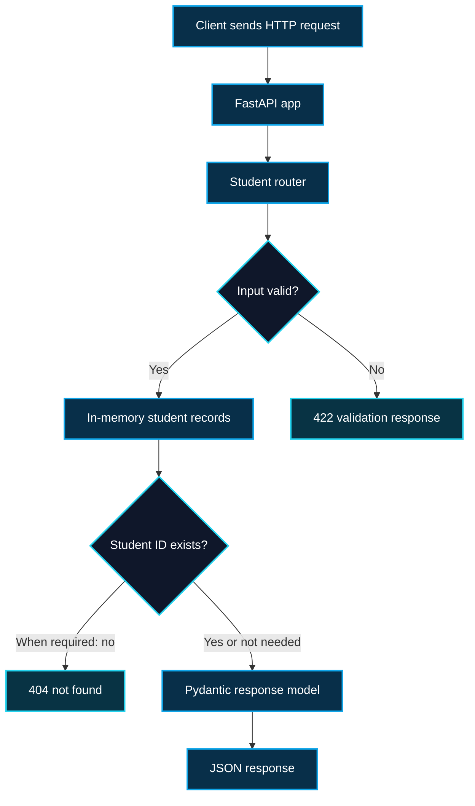

<div align="center">

<h1>🎓 Student Management API</h1>

<p><strong>A clean REST API built with Python, FastAPI and Pydantic</strong></p>

<p>Create, view, update and delete student records through simple HTTP endpoints.<br>Built to practice backend development, request validation and API design.</p>

<p>
  
  
  
  
</p>

<p>
  
  
  
</p>

<p>
  <a href="#quick-start"></a>
  <a href="#api-reference"></a>
  <a href="#api-documentation"></a>
</p>

<sub>Student backend project · Clear structure · Easy to run locally</sub>

</div>

---

## 🔷 1. Project Overview

**Student Management API** is a Python backend project for managing student records using HTTP requests. I built it to practice how a REST API is structured, how requests are validated, and how a backend sends consistent JSON responses.

The application starts with three sample students and keeps records in a Python dictionary during runtime. It uses separate modules for API routes, validation schemas and application settings.

| Project detail | Current implementation |
|---|---|
| 🎯 **Purpose** | Student record management through a REST API |
| 🐍 **Language** | Python 3.10+ |
| ⚡ **Framework** | FastAPI |
| 🧩 **Validation** | Pydantic v2 |
| 💾 **Storage** | In-memory Python dictionary |
| 🌐 **API access** | HTTP requests and JSON responses |
| 📚 **Documentation** | Swagger UI and ReDoc |

> [!NOTE]
> This is a working **in-memory CRUD API** created as a student backend project. It does not require a database, login system or external API keys.

---

## ✅ 2. Implemented Features

| Feature | What the application actually does |
|---|---|
| ➕ **Create student** | Validates a name and assigns a numeric student ID |
| 📋 **List students** | Returns every stored student as a JSON array |
| 🔎 **Get student** | Finds a student using an integer ID |
| ✏️ **Update student** | Replaces the name of an existing student |
| 🗑️ **Delete student** | Removes a student and returns a confirmation message |
| 🛡️ **Input validation** | Trims names, checks 2–50 characters and rejects digits |
| ⚠️ **Error responses** | Returns 404 for missing students and 422 for invalid requests |
| 🌍 **CORS** | Allows a configurable frontend origin with specified methods and headers |
| 📖 **API docs** | Exposes Swagger UI, ReDoc and the OpenAPI schema |

**Included sample records on startup:** `1 → Ali`, `2 → Ahmad`, `3 → Huzaifa`.

---

## 🧰 3. Technology Stack

<p>
  
  
  
  
  
</p>

| Tool / library | Role in this project |
|---|---|
| **FastAPI** | Defines the application, routes, response models and HTTP errors |
| **Pydantic v2** | Validates student names and defines request/response data models |
| **pydantic-settings** | Reads configuration from environment variables and `.env` |
| **python-dotenv** | Provides environment-file support |
| **Uvicorn** | Runs the ASGI application locally |
| **Python dictionary** | Stores the active student records in memory |

The supplied `requirements.txt` lists packages without fixed version numbers.

---

## 🧱 4. Project Architecture & Folder Structure

```text
student-management-api/
│
├── app/
│   ├── __init__.py
│   ├── main.py
│   ├── config.py
│   │
│   ├── routers/
│   │   ├── __init__.py
│   │   └── students.py
│   │
│   └── schemas/
│       ├── __init__.py
│       └── student.py
│
├── .env.example
├── .gitattributes
├── .gitignore
├── README.md
└── requirements.txt
```

### Request flow



> The **active** student dictionary is located in `app/routers/students.py`. A second dictionary appears in `app/main.py` but is not used by the registered routes.

---

## 📁 5. File-by-File Explanation

| File | Responsibility |
|---|---|
| `app/main.py` | Creates the FastAPI app, sets the title/version, configures CORS and registers the student router |
| `app/config.py` | Declares settings for the app name, version and allowed frontend origin |
| `app/routers/students.py` | Implements all five endpoints and maintains the active in-memory records |
| `app/schemas/student.py` | Defines Pydantic request/response models and student-name validators |
| `app/__init__.py` | Marks `app` as a Python package |
| `app/routers/__init__.py` | Marks `routers` as a Python package |
| `app/schemas/__init__.py` | Marks `schemas` as a Python package |
| `.env.example` | Template for local environment settings; does not contain secrets |
| `.gitignore` | Excludes `.env`, virtual environments, Python caches and pytest cache |
| `.gitattributes` | Configures text line-ending normalization in Git |
| `requirements.txt` | Lists application dependencies |
| `README.md` | Documents the code, endpoints and setup process |

The ZIP also contains local `.git/`, `.venv/` and generated `__pycache__/` directories. They are not part of the application source structure shown above.

---

<a id="api-reference"></a>

## 🌐 6. API Endpoints Reference

**Local base URL:** `http://127.0.0.1:8000`

| HTTP method | Endpoint | Purpose | Success | Possible error |
|---|---|---|---|---|
| `POST` | `/students` | Add a student | **201** | 422 |
| `GET` | `/students` | List students | **200** | — |
| `GET` | `/students/{student_id}` | Find by ID | **200** | 404, 422 |
| `PUT` | `/students/{student_id}` | Update a name | **200** | 404, 422 |
| `DELETE` | `/students/{student_id}` | Delete a student | **200** | 404, 422 |

`student_id` is an integer path parameter. The API does not currently require user authentication or an API token.

### Request and response models

| Pydantic model | Fields | Used for |
|---|---|---|
| `StudentCreate` | `name: str` | Create and update request bodies |
| `StudentResponse` | `student_id`, `name`, `message` | Create, retrieve and update responses |
| `StudentListItem` | `student_id`, `name` | Entries returned by the list endpoint |
| `StudentDeleteResponse` | `student_id`, `message` | Delete confirmation |

---

## 🧪 7. Request & Response Examples

These examples assume a **fresh server**, which starts with IDs `1`, `2` and `3`. Creating Sara therefore gives ID `4`.

### ➕ Create — `POST /students`

**Request:**

```json
{
  "name": "Sara"
}
```

**Response · 201 Created:**

```json
{
  "student_id": 4,
  "name": "Sara",
  "message": "Student Created"
}
```

### 📋 List — `GET /students`

**Response · 200 OK** (after creating Sara):

```json
[
  {"student_id": 1, "name": "Ali"},
  {"student_id": 2, "name": "Ahmad"},
  {"student_id": 3, "name": "Huzaifa"},
  {"student_id": 4, "name": "Sara"}
]
```

### 🔎 Retrieve — `GET /students/4`

**Response · 200 OK:**

```json
{
  "student_id": 4,
  "name": "Sara",
  "message": "Student Found"
}
```

### ✏️ Update — `PUT /students/4`

**Request:**

```json
{
  "name": "Sara Khan"
}
```

**Response · 200 OK:**

```json
{
  "student_id": 4,
  "name": "Sara Khan",
  "message": "Student Updated"
}
```

### 🗑️ Delete — `DELETE /students/4`

**Response · 200 OK:**

```json
{
  "student_id": 4,
  "message": "Student Deleted Successfully"
}
```

### ⚠️ Not found — `GET /students/999`

**Response · 404 Not Found:**

```json
{
  "detail": "Student not Found"
}
```

> The get-by-ID route uses `Student not Found`; the update and delete routes use `Student not found`. These are the exact strings in the uploaded source.

---

## 🛡️ 8. Pydantic Validation & Error Handling

The same `StudentCreate` schema validates the `name` field in **POST** and **PUT** requests.

| Rule | Actual behavior |
|---|---|
| **Trim spaces** | Removes leading and trailing spaces before checking length |
| **Required name** | Rejects a missing `name` field |
| **Length** | Accepts 2–50 characters after trimming |
| **Digits** | Rejects a name if any character is a numeric digit |
| **Input type** | Pydantic checks that the field is a string |

**Examples:** `"  Sara  "` becomes `"Sara"` and is accepted; `"A"` and `"Ali2"` are rejected. The current validator does **not** explicitly reject punctuation or every non-alphabetic character.

### Validation response · 422

For the request body `{"name":" x "}`, trimming produces `"x"`, which is too short. A representative validation response is:

```json
{
  "detail": [
    {
      "type": "string_too_short",
      "loc": ["body", "name"],
      "msg": "String should have at least 2 characters",
      "input": "x",
      "ctx": {"min_length": 2}
    }
  ]
}
```

Depending on installed FastAPI/Pydantic versions, error objects can contain additional fields.

**HTTP 404** is raised explicitly for missing student IDs. **HTTP 422** is returned automatically for request validation errors and invalid integer path parameters.

---

## 🌍 9. CORS Configuration

The application registers FastAPI's `CORSMiddleware` in `app/main.py`.

| Setting | Configured value |
|---|---|
| Allowed frontend origin | `settings.frontend_origin` |
| Default origin | `http://localhost:3000` |
| Allowed methods | `GET`, `POST`, `PUT`, `DELETE` |
| Allowed headers | `Content-Type`, `Authorization` |
| Allow credentials | `False` |

Set `FRONTEND_ORIGIN` in `.env` to the URL used by your frontend. The **scheme, hostname and port** must match; for instance, `localhost:3000` and `127.0.0.1:3000` are different origins.

> [!IMPORTANT]
> CORS controls browser cross-origin access. It is **not** a login or authorization mechanism.

---

## ⚙️ 10. Environment Variables & Configuration

The `Settings` class in `app/config.py` reads environment variables and an optional `.env` file. Start with the provided `.env.example`:

```powershell
Copy-Item .env.example .env
```

Then edit the local `.env` as needed:

```dotenv
APP_NAME=Student Management API
APP_VERSION=1.0.0
FRONTEND_ORIGIN=http://localhost:3000
```

| Variable | Purpose |
|---|---|
| `APP_NAME` | Title shown in FastAPI/OpenAPI documentation |
| `APP_VERSION` | API version displayed in generated documentation |
| `FRONTEND_ORIGIN` | Browser origin allowed by CORS |

All three have defaults in `app/config.py`. **No API secrets, database credentials or external service keys are required.** The `.env` file is excluded from Git tracking by `.gitignore`.

---

<a id="quick-start"></a>

## 🚀 11. Installation & Setup — Windows PowerShell

**You need:** Python 3.10+, Git and Windows PowerShell.

### Step 1 · Clone the repository

```powershell
git clone https://github.com/huzaifa2612/student-management-api.git
cd student-management-api
```

### Step 2 · Create a virtual environment

```powershell
py -m venv .venv
```

If `py` is unavailable, use `python -m venv .venv`.

### Step 3 · Activate it

```powershell
.\.venv\Scripts\Activate.ps1
```

If PowerShell blocks activation, enable scripts only for the **current terminal session**:

```powershell
Set-ExecutionPolicy -Scope Process -ExecutionPolicy RemoteSigned
.\.venv\Scripts\Activate.ps1
```

### Step 4 · Install dependencies

```powershell
python -m pip install -r requirements.txt
```

### Step 5 · Create local configuration

```powershell
Copy-Item .env.example .env
```

You can keep the default values initially. There is no database to set up.

---

## ▶️ 12. Running the Application

From the project root, with your virtual environment activated:

```powershell
python -m uvicorn app.main:app --reload
```

Once the server starts, open:

| Resource | Local address |
|---|---|
| Student API | `http://127.0.0.1:8000/students` |
| Swagger UI | `http://127.0.0.1:8000/docs` |
| ReDoc | `http://127.0.0.1:8000/redoc` |
| OpenAPI JSON | `http://127.0.0.1:8000/openapi.json` |

Press **Ctrl + C** to stop the server.

> Use `app.main:app` because the application instance is inside `app/main.py`. A root `GET /` endpoint is not defined.

### Try it directly in PowerShell

List students:

```powershell
Invoke-RestMethod -Uri "http://127.0.0.1:8000/students" -Method Get
```

Create a student:

```powershell
Invoke-RestMethod -Uri "http://127.0.0.1:8000/students" -Method Post -ContentType "application/json" -Body '{"name":"Sara"}'
```

---

<a id="api-documentation"></a>

## 📖 13. Swagger UI & ReDoc Documentation

FastAPI automatically generates documentation from the registered endpoints and Pydantic models.

<p>
  <a href="http://127.0.0.1:8000/docs"></a>
  <a href="http://127.0.0.1:8000/redoc"></a>
</p>

- **Swagger UI (`/docs`)** — inspect endpoints, provide request bodies and click **Try it out**.
- **ReDoc (`/redoc`)** — read the generated reference documentation.
- **OpenAPI JSON (`/openapi.json`)** — access the machine-readable API schema.

These links work **after the application is running locally**. Routes appear under the **Students Management** tag.

---

## ⚠️ 14. Current Project Limitations

The CRUD functionality works, but this project is intentionally scoped as an in-memory backend.

| Current limitation | What it means |
|---|---|
| **No persistent database** | Changes disappear after restarting the server; the three sample records return |
| **No authentication** | No login, JWT or user authorization is implemented |
| **No database ORM** | PostgreSQL, SQLite and SQLAlchemy are not connected |
| **No project test suite** | The ZIP does not include dedicated Pytest tests |
| **No deployment setup** | No Docker or hosting configuration is included |
| **No filtering/pagination** | The list endpoint returns all current students |
| **Simple ID assignment** | Uses `max(existing IDs) + 1`; deleting the highest ID can allow reuse |
| **Unused duplicate dictionary** | `app/main.py` contains student data not used by the router |
| **Unpinned dependencies** | `requirements.txt` does not lock package versions |

---

## 🔮 15. Future Improvements

These are **ideas for future work** and are not part of the current code:

- Add persistent storage using SQLite or PostgreSQL and a suitable data-access layer.
- Add authentication and authorization to protect changes.
- Write automated API tests for CRUD operations and validation errors.
- Improve student ID generation and remove unused duplicate data.
- Add pagination, filtering, sorting and additional student fields if needed.
- Lock dependency versions and introduce continuous integration checks.
- Add Docker support and deployment documentation.

---

## 👨‍💻 16. Author & Repository

**Muhammad Huzaifa** · Computer Science student

<p>
  <a href="https://github.com/huzaifa2612"></a>
  <a href="https://github.com/huzaifa2612/student-management-api"></a>
</p>

Built as a hands-on FastAPI backend project to practice REST APIs, validation, modular application design and local development.

---

<div align="center">

<strong>Student Management API</strong> · Built with Python, FastAPI & Pydantic

<p>
  
  
  
</p>

</div>
